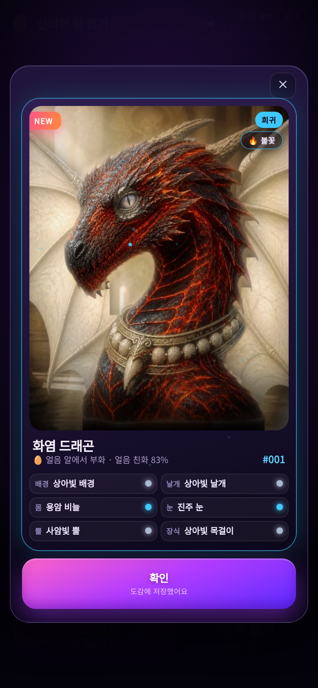
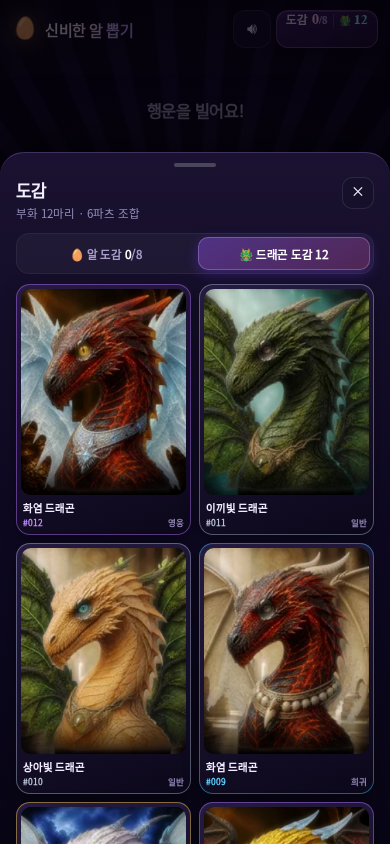
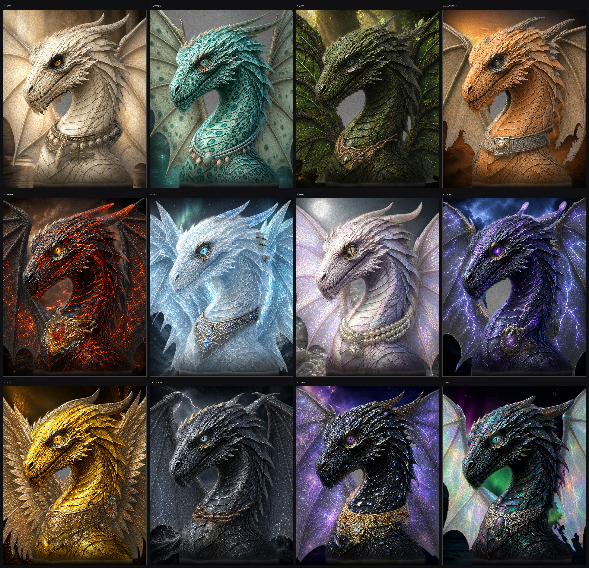
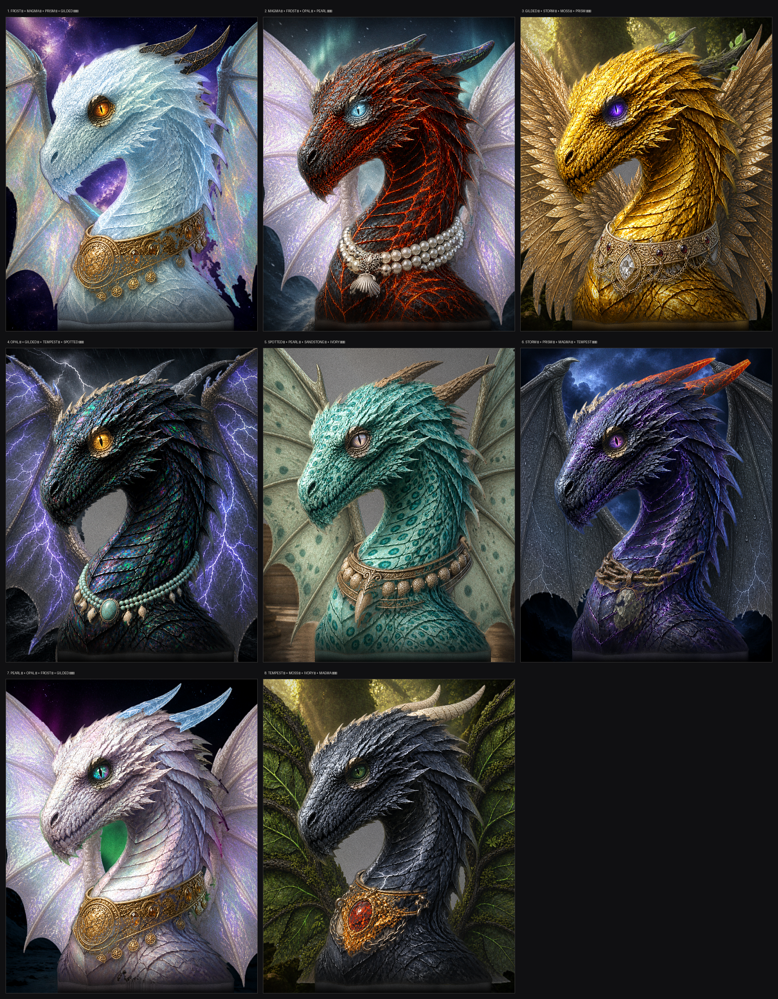
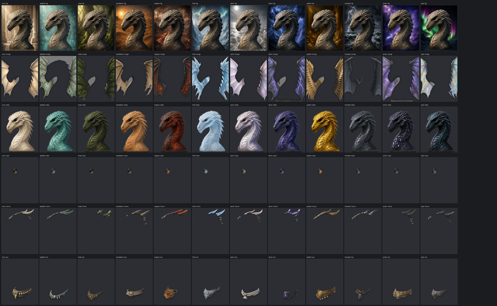

# 🥚 신비한 알 뽑기 — 드래곤 부화 가챠

모바일 우선(Mobile-first) 알 가챠. 8종의 알을 뽑아 부화시키면 **6파츠를 합성한 리얼 판타지 드래곤**이 태어납니다.
바닐라 JS + Canvas2D + Web Audio, 빌드는 Vite. GitHub Pages 하위 경로에서도 그대로 동작합니다.

| 드래곤 공개 (모바일) | 드래곤 도감 (모바일) |
| --- | --- |
|  |  |

| 12가지 테마 드래곤 | 크로스 테마 조합 8종 |
| --- | --- |
|  |  |

| 낱개 파츠 72장 (6슬롯 × 12) |
| --- |
|  |

## 게임 흐름

1. **알 뽑기** — 3D 카드 룰렛에서 8종의 알 중 하나가 나옵니다.
2. **알 깨기** — 룰렛이 멈추면 카드 아래 `알 깨기! 🥚💥` 큐가 뜹니다(카드 탭도 가능). 5연속은 5개 모두 대기하며, `다음 알 부화`로 연속 부화할 수 있습니다.
3. **드래곤 공개** — 4:5 버스트에 6레이어로 합성된 드래곤 + **특성 6개** + **희귀도·속성 배지** + 시리얼.
4. **도감** — `알 도감`(8칸)과 `드래곤 도감`(4:5 그리드, 탭하면 6특성·알 출처 상세) 두 탭. 모두 `localStorage`에 저장됩니다.

| 등급 | 알 | 확률 |
| --- | --- | --- |
| 일반 | 하얀 알 · 점박이 알 · 숲의 알 | 30% · 26% · 20% (합 76%) |
| 희귀 | 불꽃 알 · 얼음 알 | 11% · 8% (합 19%) |
| 영웅 | 번개 알 · 황금알 | 3.2% · 1.4% (합 4.6%) |
| 전설 | 다이아몬드알 | 0.4% |

## 🐲 6레이어 드래곤 파츠 시스템

모든 드래곤은 **하나의 마스터 앵커 페인팅**(`tools/proto-art/master/base.png`, 1122×1402, 뿔 없는 3/4 버스트)에서
파생된 6개 레이어를 뒤→앞으로 합성한 것입니다. 모든 파츠가 같은 픽셀 좌표계를 공유하므로
**어떤 조합이 나와도 어긋남·겹침·뜨는 파츠가 없습니다.**

| 순서 | 슬롯 | 내용 | 파츠 수 |
| --- | --- | --- | --- |
| 1 | `bg` | 배경 (상아빛 신전, 민트 석호, 이끼 숲, 사암 사막, 화산 칼데라, 빙하 계곡, 진주 해변, 뇌우, 황금 보물고, 폭풍우 바다, 성운, 오로라) | 12 |
| 2 | `wings` | 날개 (뼈·점박이·이끼·사암·용암·빙정·진주·플라스마·황금깃·폭풍·성운·오팔) | 12 |
| 3 | `body` | 몸·머리·목 — **마스터 실루엣 고정** (상아빛·점박이·이끼·사암·용암 흑요석·빙하·진주·뇌광·24K 황금·폭풍 강철·다이아·오팔) | 12 |
| 4 | `eyes` | 눈 (호박·청록·에메랄드·구리·용암·서리·진주·보랏빛·순금·폭풍·은하·오팔) | 12 |
| 5 | `horns` | 뿔 (뼈·해유리·드리프트우드·사암·바살트·얼음 결정·나전·뇌광·황금 세공·폭풍 강철·흑요석·오팔) | 12 |
| 6 | `acc` | 목 장식 (뼈 토크·청록 구슬·덩굴·사암·용암 고르제·은빛·진주·플라스마·황금 고르제·쇠사슬·왕실·은세공) | 12 |

**합계 72개 파츠** = 8개 알 테마(white·spotted·forest·fire·ice·thunder·gold·diamond) + 희귀도 크로스 4종(sandstone·pearl·tempest·opal).
파츠는 4:5(640×800) 투명 WebP(전체 3.8MB)이고, 갤러리용 192×240 썸네일 파츠를 따로 두어 도감에서 수십 마리를 열어도 부담이 없습니다.
한 마리 부화에 필요한 6장은 최대 약 470KB입니다.

### 80% 속성 친화

알의 속성(`white` `spotted` `forest` `fire` `ice` `thunder` `golden` `diamond`)에 대해 **슬롯마다 독립적으로**
80% 확률로 같은 속성 계열(예: 얼음 ↔ 하양, 불꽃 ↔ 황금, 번개 ↔ 황금) 파츠, 20% 확률로 다른 속성 파츠를 뽑습니다.
뽑힌 풀 안에서는 희귀도 가중치(일반 50 · 희귀 30 · 영웅 15 · 전설 5)로 선택됩니다.

```
affinity overall 0.7997 · bg 0.802 wings 0.795 body 0.799 eyes 0.804 horns 0.801 acc 0.797 (n=105,600 롤)
```

## 구현 포인트

### 1. 마스터 앵커 파이프라인 (`tools/proto-art/`)

- `master/base.png` — 뿔 그루터기를 지운 3/4 버스트 앵커. 모든 파츠의 픽셀 기준.
- `gen.py` — `images --edit master/base.png`로 슬롯별 변형을 만듭니다. 프롬프트가 포즈·카메라·크롭·조명을 고정하고
  한 슬롯만 바꾸므로, 변형에서 달라진 픽셀이 곧 그 슬롯의 파츠입니다. 변형마다 실루엣 IoU를 측정해 기록합니다.
- `pipeline.py` — 변형에서 RGBA 파츠를 깎아내고(`out/layers/`), 6×12 파츠를 640×800 WebP + 192×240 썸네일로 내보내고,
  `src/dragon-parts.js` 카탈로그를 씁니다. QC(`out/qc.json`)가 빈 파츠·배경 번짐·영역 이탈을 잡아냅니다.

파츠 매트의 핵심은 **"배경을 색으로 판정하지 않는 것"** 입니다. 생성 모델은 회색 판 위에 옅은 그라디언트를 남기고,
옅은 뿔·날개는 판과 거의 같은 밝기라 색 임계값으로는 절대 갈리지 않습니다.

- `bg_flood()` — 테두리에서 시작해 **엣지를 넘지 못하는** 플러드필로 배경을 찾습니다(그라디언트에 강함).
- `plate_field()` — 그 배경을 push-pull로 파츠 뒤까지 확장한 "판 예상값"과의 차이로 날개·뿔을 땁니다.
- `notch` — 턱과 목 사이, 판이 보이는 목구멍 홈은 마스터에서 한 번 찾아 모든 파츠에서 제외합니다.
- 눈은 검은 소켓과 밝기가 비슷해 차이만으로는 잘리므로 **소켓 타원**을 알파로 쓰고, 번지는 빛만 더합니다.
- `acc`(목걸이)는 얇은 사슬이 임계값 아래로 사라지지 않게 밴드를 살짝 키운 뒤 변화 픽셀로 되깎습니다.

### 2. 런타임 합성기 (`src/dragon-compose.js`)

프로토타입의 마감 패스를 Canvas2D로 옮겼습니다. 6장을 겹쳐 그린 뒤:

1. **환경 림 라이트 / 라이트 랩** — 배경 판의 빛을 실루엣 바깥 밴드와 안쪽 가장자리에 얹습니다.
2. **환경 톤 패스** — 배경의 저주파 색을 `multiply`로 전체에 곱해 한 조명 아래로 통일합니다.
   (불 배경 + 얼음 몸도 같은 빛을 받은 것처럼)
3. **블룸 · 접지 그림자 · 캔버스 그레인 · 비네트 · 최종 그레이드**.

이 톤 패스 덕분에 크로스 테마(빙하 몸 + 용암 눈 + 황금 뿔 + 진주 목걸이)가 한 그림처럼 붙습니다.
공개 카드는 합성 결과를 이미지로 구워 보여주고(캔버스 텍스처가 갱신되지 않는 합성기 회피), 도감은 240×300으로 구워 캐시합니다.
레이어 비트맵은 LRU(18장)로, 카드 이미지는 6장까지만 보관해 5연속 부화에서도 메모리가 쌓이지 않습니다.

### 3. 속성 오라 (`src/dragon-aura.js`)

드래곤의 **몸 실루엣**을 읽어(80×100 알파 굽기 → 윗변·등선 좌표) 그 속성만의 공기를 카드 위에 실시간으로 그립니다.

| 속성 | 오라 |
| --- | --- |
| 🔥 불꽃 | 볏·목덜미·등 실루엣에서 솟는 불혀, 타오르는 잔불, 떠오르는 불티 |
| ❄️ 얼음 | 비스듬히 몰아치는 눈보라 줄기, 흩날리는 눈송이, 얼음 안개 |
| 🌿 숲 | 오른쪽 위에서 쏟아지는 햇살(god-ray), 떠다니는 꽃가루·빛입자 |
| ⚡ 번개 | 실루엣을 타고 튀는 방전 아크, 사방으로 흩어지는 스파크 |
| 👑 황금 | 머리 둘레의 금빛 후광, 반짝이는 별 플레어, 황금 가루 |
| 💎 다이아 | 무지개빛 프리즘 글린트와 결정 반짝임 |
| 🤍 하양 · 🩵 점박이 | 낮은 안개의 흐름과 부드러운 빛입자 (일반 등급도 살아 있게) |

한 장의 카드 = **rAF 루프 하나**. 모달을 닫거나 카드를 바꾸면 `cancelAnimationFrame`으로 즉시 정지하고,
`prefers-reduced-motion`이면 애니메이션 없이 정지 프레임 한 장만 그립니다.
파티클은 전부 미리 구운 스프라이트(`drawImage`)와 단순 경로라 프레임당 할당이 없습니다.
공개·상세 카드에는 이 살아있는 층이, 도감 썸네일에는 같은 팔레트의 **구운(정지) 오라**가 들어가
그리드가 수십 장이어도 60fps를 유지합니다.

### 4. 그 외

- **3D 카드 룰렛** — `perspective` 안의 `translate3d + rotateY + scale` 릴, 가속→감속→스냅.
- **연출** — Canvas 선버스트·번개·파티클·충격파·플래시·셰이크, 부화 크랙, 등급별 팡파레(Web Audio 합성).
- **저장** — `egg-gacha.collection.v1`(알), `egg-gacha.dragons.v1`(드래곤, 최대 240), `egg-gacha.pending.v1`(부화 대기 알).

## 개발

```bash
npm install
npm run dev      # http://localhost:5173
npm run build    # dist/
npm test         # 알 가챠 회귀 테스트 (헤드리스)
npm run dragon   # 파츠·80% 친화·부화·도감 테스트
npm test:all     # 위 두 개
npm run shots:dragon
npm run live     # 배포본 라이브 검증
```

### 파츠 아트 재생성

```bash
cd tools/proto-art
python3 gen.py                 # 변형 72장 생성 (있는 파일은 skip, -j 4 로 병렬)
python3 pipeline.py parts      # RGBA 파츠 72개 + WebP/썸네일 + 카탈로그 + QC
python3 pipeline.py atlas      # 낱개 파츠 콘택트 시트
python3 pipeline.py mix        # 파츠별로 기본 몸에 얹어 본 시트 (매트 검사)
python3 pipeline.py sheet      # 테마 12종 + 크로스 8조합 시트
```

파츠를 추가하려면 `gen.py`의 `PARTS`/`ART`와 `pipeline.py`의 `PARTS`에 한 줄씩 넣고 두 스크립트를 다시 돌립니다.

## 폴더 구조

```
index.html
vite.config.js          base: './' (GitHub Pages 하위 경로)
src/
  main.js               화면 조립, 뽑기·부화 시퀀스, 도감
  dragon.js             6슬롯 롤 & 80% 친화, 이름/속성
  dragon-parts.js       (자동생성) 파츠 카탈로그
  dragon-compose.js     런타임 Canvas 합성기 (톤·림·블룸·비네트)
  dragon-collection.js  드래곤·대기 알 저장
  dragon-thumb.js       도감용 4:5 합성 썸네일
  roulette.js · fx.js · audio.js · collection.js · data.js · style.css
  assets/eggs/*.webp
public/parts/           72 파츠 + thumb/ 192×240 썸네일
tools/
  proto-art/            마스터 앵커 · 생성 · 매트/합성 파이프라인
  test.mjs / dragon-test.mjs / dragon-shots.mjs / live-check.mjs
shots/                  스크린샷
```

## 배포

`main`에 소스, `gh-pages` 브랜치에 `dist/` 내용 + `.nojekyll`이 들어 있습니다.

```bash
npm run build
git worktree add -b gh-pages --orphan .tools/tmp/pages   # 또는 기존 gh-pages 재사용
cp -r dist/. .tools/tmp/pages && touch .tools/tmp/pages/.nojekyll
git -C .tools/tmp/pages add -A && git -C .tools/tmp/pages commit -m "deploy"
git -C .tools/tmp/pages push origin gh-pages --force
```

→ https://netgamer.github.io/egg-gacha/
