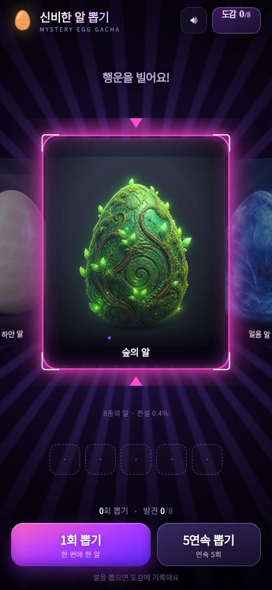
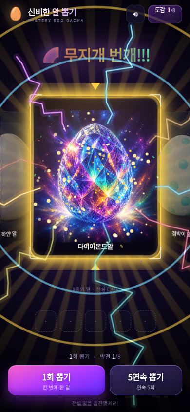
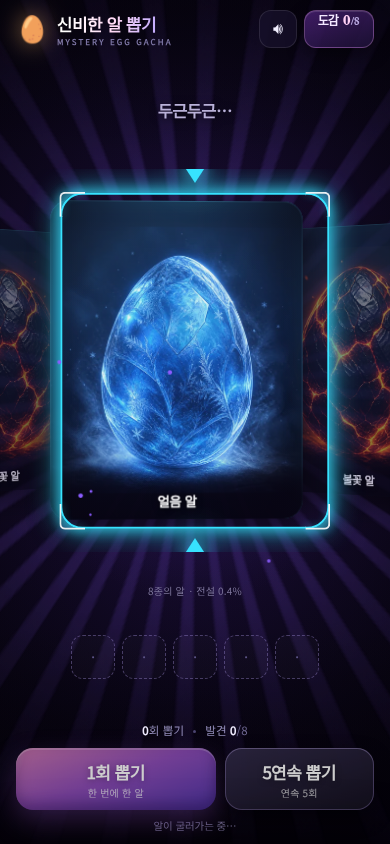
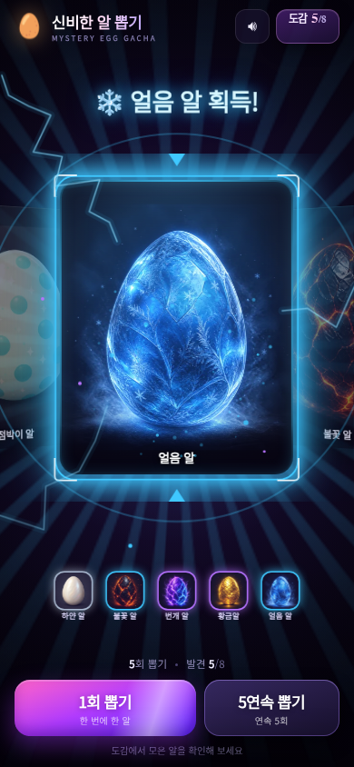
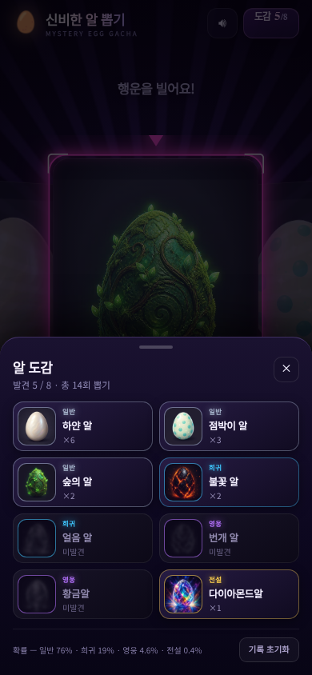
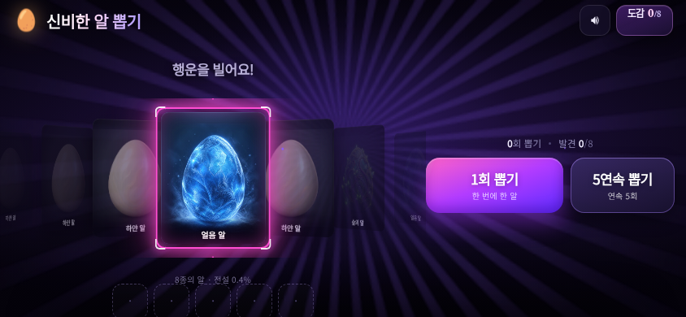

# 🥚 신비한 알 뽑기 — 미스터리 에그 가챠

모바일 우선(Mobile-first) 가챠 룰렛 웹앱. 8종의 신비한 알을 뽑아 모으고, 등급별 연출과 사운드로 당첨의 쾌감을 살렸습니다.
바닐라 JS + Canvas2D + Web Audio API, 빌드는 Vite. GitHub Pages 하위 경로에서도 그대로 동작합니다.

| 준비 화면 | 전설 당첨 연출 |
| --- | --- |
|  |  |

| 3D 룰렛 회전 | 5연속 결과 |
| --- | --- |
|  |  |

| 알 도감 | 가로 모드 |
| --- | --- |
|  |  |

데스크톱(1280×800)에서도 같은 화면이 가운데 정렬되어 동작합니다 — `shots/desktop-ready.png`.

## 게임 규칙

| 등급 | 알 | 확률 |
| --- | --- | --- |
| 일반 | 하얀 알 · 점박이 알 · 숲의 알 | 30% · 26% · 20% (합 76%) |
| 희귀 | 불꽃 알 · 얼음 알 | 11% · 8% (합 19%) |
| 영웅 | 번개 알 · 황금알 | 3.2% · 1.4% (합 4.6%) |
| 전설 | 다이아몬드알 | 0.4% |

- **1회 뽑기**: 4.3초 롱 스핀 → 감속 → 중앙 정확 착지 → 등급별 연출
- **5연속 뽑기**: 첫 알은 극적으로, 이후 4개는 빠르게 연속 공개(약 9초)
- 등급별 배너: `🌈 무지개 번개!!!`(전설) · `⚡ 황금 번개!!`(황금알) · `⚡ 번개 알 강림!!` · `✨ 희귀/획득!`
- 도감: 8칸, 발견 수·개별 획득 횟수·확률 표시, `localStorage`에 저장 (기록 초기화는 두 번 눌러 확인)

## 구현 포인트

- **3D 카드 룰렛** — 카드 스트립을 `perspective` 안에서 `translate3d + rotateY + scale`로 배치, 중앙에서 멀어질수록 뒤로·작게·어둡게. `requestAnimationFrame` 물리로 가속 → 감속 → 끝에서 살짝 흔들리는 스냅.
- **중앙 슬롯 연출** — 상·하단 삼각 마커 + 등급 색 네온 프레임(모서리 하이라이트), 스핀 중 프레임 색이 바뀝니다.
- **Canvas 이펙트** — 방사형 선버스트(프리렌더 휠 회전), 번개(카드 뒤에서 바깥으로 뻗는 지그재그), 스파크·컨페티·충격파 링, 카드 중심에서 퍼지는 방사형 플래시, 화면 흔들림.
- **사운드** — Web Audio로 합성한 틱(카드가 중앙을 지날 때마다, 속도에 따라 음높이 변화), 등급별 팡파레·천둥, 음소거 토글은 저장됩니다.
- **성능** — 글루 레이어 캔버스는 30fps + 해상도 상한, 선버스트는 512px 프리렌더 1장 회전. 저사양 안드로이드에서도 부드럽게 돌도록 맞췄습니다.
- **접근성** — 버튼 `aria-pressed`/`aria-label`, 배너 `aria-live`, `prefers-reduced-motion`에서 반복 애니메이션 정지.

## 개발

```bash
npm install
npm run dev      # http://localhost:5173
npm run build    # dist/ (base: './' → 하위 경로 배포 가능)
npm test         # 빌드된 dist를 띄워 헤드리스 검증 (아래 참고)
npm run shots    # shots/*.png 재촬영
```

### 테스트 (`tools/test.mjs`)

`dist/`를 로컬 정적 서버로 띄우고 Playwright(Chromium)로 검증합니다. 이 샌드박스의 소프트웨어 렌더러가 무거운 합성에서 간헐적으로 죽기 때문에, 단계(phase)마다 새 브라우저 프로세스를 쓰고 렌더러 크래시는 1회 재시도합니다.

검증 항목:

- 콘솔/페이지/네트워크 오류 0, 8개 알 이미지 512×512 로드(HTTP 200)
- 390×844·360×640 세로, 844×390 가로, 1280×800 데스크톱에서 오버플로 없음
- 전설 강제 당첨 시 중앙 카드 일치, 배너 등급 스타일, 파티클·번개·화면 흔들림 발생, 도감/카운터 갱신
- 5연속: 칩 5개, 5회 기록, 스핀 중 버튼 잠금/해제
- 도감: 저장값 복원, 발견/미발견 표시, 확률 문구, 두 번 눌러 초기화
- `localStorage` 새로고침 유지, 소리 토글 상태

`npm run subpath`는 `gh-pages` 브랜치 내용을 `/tmp/ghtest/egg-gacha/`에 풀어 `http://127.0.0.1:<port>/egg-gacha/` 로 열어 봅니다. GitHub Pages의 하위 경로 서빙을 그대로 재현한 검증입니다.

```bash
# 실행 (샌드박스 기준 환경변수)
export PATH=/workspace/.tools/node-v22.23.5-linux-x64/bin:$PATH
export PLAYWRIGHT_BROWSERS_PATH=/workspace/.tools/pw-browsers
export LD_LIBRARY_PATH=/workspace/.tools/syslibs
npm test
```

## 알 이미지 재생성

`src/assets/eggs/*.webp`는 512×512로 최적화된 결과물입니다(합 336KB). 원본 1254px PNG는 `assets-src/eggs/`에 있으며(git 제외), `images` CLI로 다시 만들 수 있습니다.

```bash
images 'a single glossy ivory-white mystery egg with subtle pearlescent sheen, 3D stylized game item illustration, centered, dark charcoal background, soft studio lighting, no text, square composition' --out assets-src/eggs/white-egg.png
python3 tools/optimize-eggs.py     # assets-src/*.png → src/assets/eggs/*.webp (512px)
```

나머지 7종(`spotted`, `forest`, `fire`, `ice`, `thunder`, `golden`, `diamond`)도 같은 형식의 영문 프롬프트로 생성했습니다. 모두 어두운 배경 + 중앙 알 + 등급에 맞는 조명.

## 폴더 구조

```
index.html
vite.config.js          base: './' (GitHub Pages 하위 경로)
src/
  main.js               화면 조립, 뽑기 시퀀스, 도감, 배너
  roulette.js           3D 카드 릴(위치 p, 감속·스냅·틱 콜백)
  fx.js                 Canvas: 선버스트·번개·파티클·링·플래시·셰이크
  audio.js              Web Audio 합성음
  collection.js         localStorage 도감
  data.js               알 8종, 등급, 확률, 배너 문구
  style.css
  assets/eggs/*.webp
tools/                  test.mjs · shots.mjs · server.mjs · optimize-eggs.py
shots/                  완성 화면 스크린샷
```

## 배포

`main`에 소스, `gh-pages` 브랜치에 `dist/` 내용 + `.nojekyll`이 준비되어 있습니다.
GitHub에 저장소를 만든 뒤:

```bash
git push -u origin main
git push -u origin gh-pages
```

저장소 Settings → Pages → Source를 `gh-pages` 브랜치(root)로 지정하면
`https://<user>.github.io/<repo>/` 에서 열립니다.
