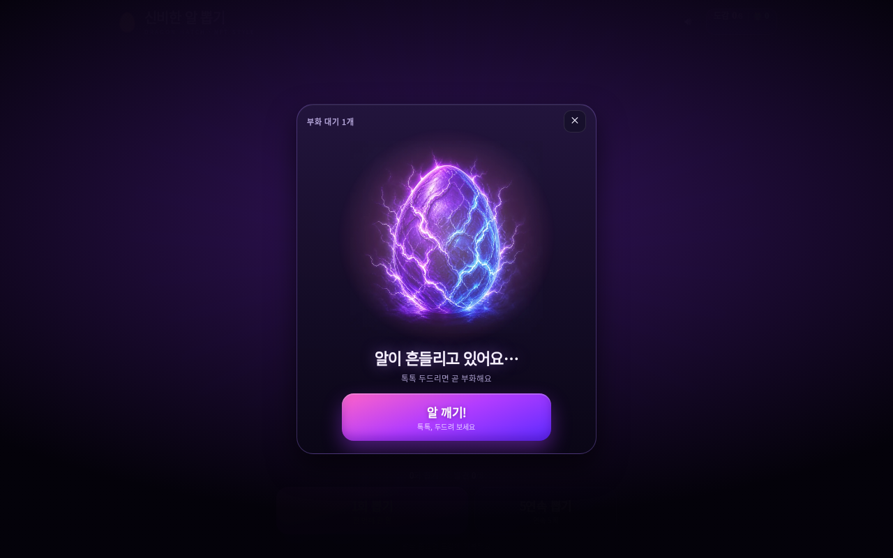
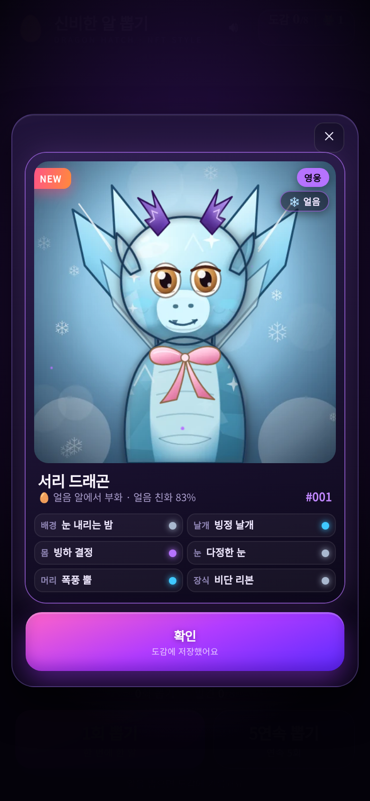
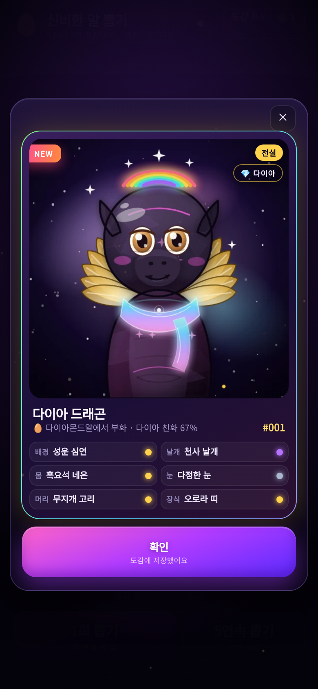
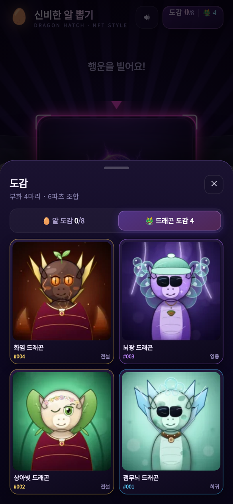
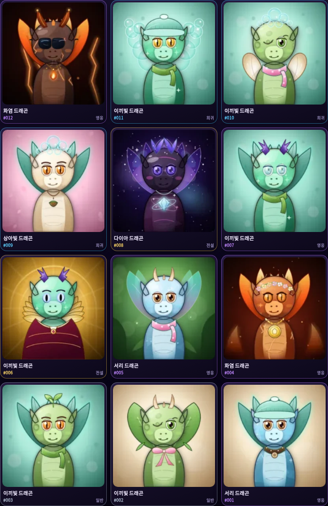

# 🥚 신비한 알 뽑기 — 드래곤 부화 가챠

모바일 우선(Mobile-first) 알 가챠. 8종의 알을 뽑아 부화시키면 **6파츠를 합성한 NFT 스타일 드래곤**이 태어납니다.
바닐라 JS + Canvas2D + Web Audio, 빌드는 Vite. GitHub Pages 하위 경로에서도 그대로 동작합니다.

| 알 부화 | 드래곤 공개 (얼음 알 → 서리 드래곤) |
| --- | --- |
|  |  |

| 다이아몬드알 공개 | 드래곤 도감 (모바일) |
| --- | --- |
|  |  |

| 합성 드래곤 12종 (4×3) |
| --- |
|  |

## 게임 흐름

1. **알 뽑기** — 3D 카드 룰렛에서 8종의 알 중 하나가 나옵니다.
2. **알 깨기** — 룰렛이 멈추면 카드 아래 `알 깨기! 🥚💥` 큐가 뜹니다(카드 탭도 가능). 5연속은 5개 모두 대기하며, `다음 알 부화`로 연속 부화할 수 있습니다.
   - 흔들림(shake) → 금이 가는 크랙 → 광선 버스트 + Web Audio 크랙/파열음 → 드래곤 카드 공개
3. **드래곤 공개** — 512×512에 6레이어로 합성된 드래곤 + **특성 6개** + **희귀도·속성 배지** + 시리얼.
4. **도감** — `알 도감`(8칸)과 `드래곤 도감`(NFT 그리드, 탭하면 6특성·알 출처 상세) 두 탭. 모두 `localStorage`에 저장됩니다.

| 등급 | 알 | 확률 |
| --- | --- | --- |
| 일반 | 하얀 알 · 점박이 알 · 숲의 알 | 30% · 26% · 20% (합 76%) |
| 희귀 | 불꽃 알 · 얼음 알 | 11% · 8% (합 19%) |
| 영웅 | 번개 알 · 황금알 | 3.2% · 1.4% (합 4.6%) |
| 전설 | 다이아몬드알 | 0.4% |

## 🐲 6레이어 드래곤 파츠 시스템

모든 드래곤은 **하나의 정규(chibi) 드래곤 흉상 템플릿**(512×512) 위에 6개 레이어를 뒤→앞으로 합성한 것입니다.
파츠는 모두 같은 좌표계에서 그려지므로 **어떤 조합이 나와도 어긋남·겹침·뜨는 파츠가 없습니다.**

| 순서 | 슬롯 | 내용 | 파츠 수 |
| --- | --- | --- | --- |
| 1 | `bg` | 배경·오라 (상아빛 방, 민트 점판, 고요한 숲, 벚꽃 하늘, 눈 내리는 밤, 불씨 연기, 용암 지대, 빙하 동굴, 에메랄드 숲, 뇌운 폭풍, 황금 신전, 프리즘 광선, 성운 심연, 육각 회로) | 14 |
| 2 | `wings` | 등 날개 (몽실·박쥐·이파리·꽃잎·거품·불꽃·태양·빙정·뇌전·오로라·천사·메카·다이아 프리즘·은하) | 14 |
| 3 | `body` | 몸통·머리·주둥이·비늘 — **정규 실루엣 고정** (상아빛·점박이·이끼·에메랄드·마그마·용광로·서리·빙하·폭풍석판·보랏빛 플라스마·24K 황금·면절정 다이아·흑요석 네온·오로라 프리즘) | 14 |
| 4 | `eyes` | 눈·표정 (다정·사나움·윙크·잉걸불·서리·선글라스·용의 눈·졸린·번개·황금 레이저·별빛·공허·은하·무지개 각성) | 14 |
| 5 | `head` | 뿔·왕관·고리 (작은 뿔·새싹·니트 비니·꽃 화관·잉걸불 뿔·서리 왕관·폭풍 뿔·번개 볏·황금 왕관·천사 고리·거품 왕관·다이아 티아라·무지개 고리·은하 뿔) | 14 |
| 6 | `acc` | 목·가슴 장식 (비단 리본·가죽 목걸이·이파리 목도리·도토리 부적·물방울 목도리·잉걸불 펜던트·서리 목걸이·달빛 펜던트·뇌전 사슬·홀로그램 문장·황금 메달·왕실 망토·다이아 코어·오로라 띠) | 14 |

**합계 84개 파츠.** 각 파츠는 512×512 투명 WebP(평균 16KB, 전체 1.3MB)이고, 갤러리용 192×192 썸네일 파츠를 따로 두어 도감에서 수십 마리를 열어도 디코드 부담이 없습니다.

### 80% 속성 친화

알의 속성(`white` `spotted` `forest` `fire` `ice` `thunder` `gold` `diamond`)에 대해 **슬롯마다 독립적으로**
80% 확률로 같은 속성 계열(예: 얼음 ↔ 하양, 불꽃 ↔ 황금) 파츠, 20% 확률로 다른 속성 파츠를 뽑습니다.
뽑힌 풀 안에서는 희귀도 가중치(일반 50 · 희귀 30 · 영웅 15 · 전설 5)로 선택됩니다.

```
affinity overall 0.7995 · bg 0.802 wings 0.799 body 0.799 eyes 0.797 head 0.800 acc 0.801 (n=105,600 롤)
```

## 구현 포인트

- **절차적 파츠 아트** — 같은 캔버스 좌표·같은 실루엣 위에 레이어별 SVG를 그리고 Chromium으로 래스터화한 뒤 WebP로 굽습니다(`tools/art/*`). 그라디언트·스케일 텍스처·균열·결정면·네온 발광을 코드로 그려 84개 파츠가 한 세트처럼 보이게 맞췄습니다.
- **6레이어 합성** — 공개 카드는 6장의 ``를 절대배치로 겹쳐 합성하고, 도감 카드는 같은 합성을 canvas로 한 장(256px)으로 구워 표시합니다.
- **3D 카드 룰렛** — `perspective` 안의 `translate3d + rotateY + scale` 릴, 가속→감속→스냅. 중앙 슬롯 마커·등급 네온 프레임.
- **연출** — Canvas 선버스트·번개·파티클·충격파·플래시·셰이크, 부화 크랙 SVG, 등급별 팡파레(Web Audio 합성).
- **성능/안정성** — 부화 화면이 열리면 아래 룰렛 레이어를 숨겨 합성 예산을 확보하고, 파티클은 단계마다 정리합니다. `prefers-reduced-motion`에서 반복 애니메이션 정지.
- **저장** — `egg-gacha.collection.v1`(알), `egg-gacha.dragons.v1`(드래곤, 최대 240), `egg-gacha.pending.v1`(부화 대기 알).

## 개발

```bash
npm install
npm run dev      # http://localhost:5173
npm run build    # dist/
npm test         # 알 가챠 회귀 테스트 (헤드리스)
npm run dragon   # 파츠·80% 친화·부화·도감 테스트
npm test:all     # 위 두 개
npm run parts    # 파츠 84개 재렌더 → public/parts/*.webp + src/dragon-parts.js
npm run shots:dragon
```

### 테스트 (`tools/test.mjs`, `tools/dragon-test.mjs`)

`dist/`를 로컬 정적 서버로 띄우고 Playwright(Chromium)로 검증합니다. 이 샌드박스의 소프트웨어 렌더러가 무거운 합성에서 간헐적으로 죽기 때문에, 단계(phase)마다 새 브라우저 프로세스를 쓰고 렌더러 크래시는 1회 재시도합니다.

`dragon-test.mjs` 검증 항목:

- 84개 파츠 HTTP 200 · 512×512 디코드 · 썸네일 192×192 · 번들 1.3MB
- **80% 친화 통계** — 8종 알 × 2,200회 = 105,600롤, 슬롯별 79.7~80.2%, 전체 79.95%
- 파츠당 희귀도 가중치 일반 > 희귀 > 영웅 > 전설
- 뽑기 → 큐 → 알 깨기 → 6특성·배지·시리얼 공개 → 저장 → 카운터
- 5연속 부화(다음 알 연속) 5마리 · 대기 0
- 새로고침 후 도감 유지 · canvas 썸네일 · 상세 모달 6특성 · 알 출처
- 모바일/데스크톱 레이아웃(부화 패널·카드 정사각·특성 2열·3열 그리드), 콘솔/페이지/404 오류 0

```bash
# 실행 (샌드박스 기준 환경변수)
export PATH=/workspace/.tools/node-v22.23.5-linux-x64/bin:$PATH
export PLAYWRIGHT_BROWSERS_PATH=/workspace/.tools/pw-browsers
export LD_LIBRARY_PATH=/workspace/.tools/syslibs
npm test:all
```

## 파츠 아트 재생성

```bash
# 1) tools/art/layers/*.mjs 의 draw() 수정
# 2) 렌더: build/parts-png/*.png → public/parts/**.webp (512 + 192 썸네일)
npm run parts
# 3) 빠른 눈검사용 콘택트 시트 (조합 12개)
python3 tools/art-sheet.py --seed 7 --out shots/dev-sheet.png
```

`tools/art/base.mjs`가 정규 드래곤 해부(머리·몸통·주둥이·눈 좌표)를 정의합니다. 파츠를 추가할 때는 이 좌표만 따르면 정렬이 자동으로 맞습니다.

## 폴더 구조

```
index.html
vite.config.js          base: './' (GitHub Pages 하위 경로)
src/
  main.js               화면 조립, 뽑기·부화 시퀀스, 도감
  dragon.js             6슬롯 롤 & 80% 친화, 이름/속성
  dragon-parts.js       (자동생성) 파츠 카탈로그
  dragon-collection.js  드래곤·대기 알 저장
  dragon-thumb.js       도감용 canvas 합성 썸네일
  roulette.js · fx.js · audio.js · collection.js · data.js · style.css
  assets/eggs/*.webp
public/parts/           84 파츠 + thumb/ 192px 썸네일
tools/
  art/                  절차적 파츠 아트 (base + layers/*)
  render-parts.mjs      파츠 렌더 → WebP + 카탈로그
  art-sheet.py          조합 콘택트 시트
  test.mjs / dragon-test.mjs / dragon-shots.mjs
shots/                  스크린샷
```

## 배포

`main`에 소스, `gh-pages` 브랜치에 `dist/` 내용 + `.nojekyll`이 들어 있습니다.

```bash
npm run build
git subtree push --prefix dist origin gh-pages   # 또는 워크트리로 복사 후 push
```

→ https://netgamer.github.io/egg-gacha/
